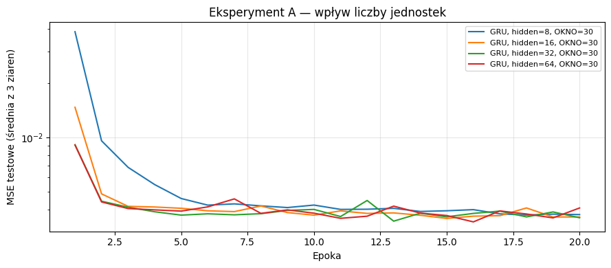
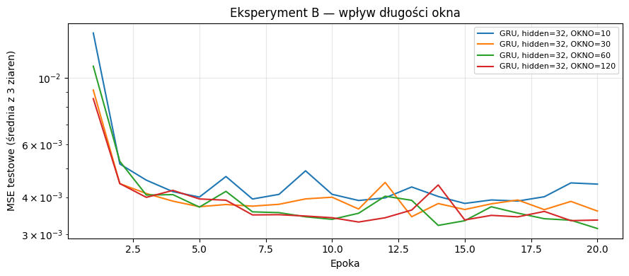
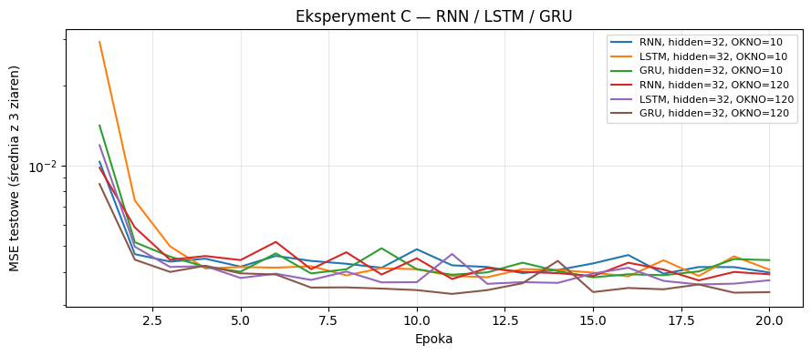
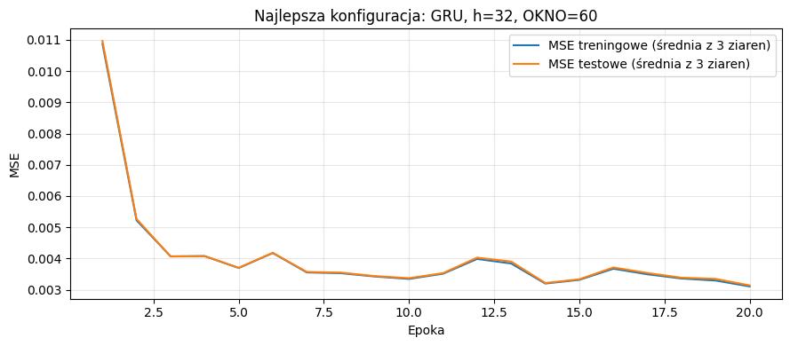
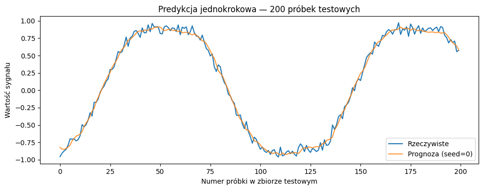

# Sprawozdanie — Laboratorium 2
**Autor / grupa:** **Oskar Pietrzak GL.03**  
**Data wykonania zajęć:** **28.10.2026**   
**Kod:** `laboratorium_02_rozwiazanie.ipynb`

## 1. Cel ćwiczenia

Celem laboratorium była implementacja i analiza sieci rekurencyjnych przewidujących kolejną próbkę syntetycznego szeregu czasowego. Badano wpływ liczby jednostek ukrytych w GRU (eksperyment A), długości okna wejściowego w GRU (eksperyment B) i typu komórki RNN/LSTM/GRU dla krótkiego i długiego okna (eksperyment C). Wyniki odniesiono do prostej prognozy równej ostatniej próbce okna.

## 2. Metoda i implementacja

**Dane.** Wygenerowano 2000 próbek sygnału `sin(t) + 0.1*sin(3*t) + 0.05*szum`, z ziarnem NumPy równym 0. Z każdego okna o długości `OKNO` przewidywano następną wartość. Podział na 80% treningu i 20% testu był chronologiczny, bez losowego mieszania przykładów między zbiorami. Dla okien 10/30/60/120 otrzymano odpowiednio 1592/398, 1576/394, 1552/388 i 1504/376 przykładów treningowych/testowych.

**Model i uczenie.** Jednowarstwowa komórka rekurencyjna (RNN, LSTM lub GRU) z wyjściem liniowym (`nn.Linear(hidden, 1)`) przewidywała jedną wartość na podstawie ostatniego stanu. Użyto optymalizatora Adam, straty MSE, przycinania normy gradientu do 5, `lr=0.01` i `batch=64`. Model bazowy uczono 30 epok, natomiast wszystkie porównywane konfiguracje po 20 epok. Każdą unikalną konfigurację powtórzono dla ziaren **0, 1 i 2**. Wynik jednego powtórzenia stanowi średnia z pięciu ostatnich wartości test MSE; podano następnie średnią i odchylenie standardowe tych trzech wyników. Czas w tabelach to średni czas samego treningu z trzech uruchomień.

**Hipotezy postawione przed eksperymentami:**

- **Eksperyment A:** Zwiększenie liczby jednostek ukrytych może zmniejszyć MSE, ale poprawa nie będzie monotoniczna, a koszt treningu wzrośnie.
- **Eksperyment B:** Wydłużenie okna GRU z 10 do 60 kroków poprawi predykcję, zaś dalsze wydłużenie do 120 może nie dać wyraźnej poprawy.

**Najważniejsze fragmenty implementacji:** BLOK 03 — tworzenie okien i podział chronologiczny; BLOK 04 — model; BLOK 05 — pętla uczenia i historie trening/test; BLOK 08 — eksperyment z trzema ziarnami i obliczanie statystyk.

## 3. Wyniki

### 3.1. Model bazowy i punkt odniesienia

Bazowy **RNN, hidden=32, OKNO=30 (30 epok)** uzyskał test MSE po ostatniej epoce równy **0,003769**, a średnia test MSE z ostatnich pięciu epok wyniosła **0,003857**. Dla tego samego okna heurystyka „następna wartość = ostatnia próbka” uzyskała **0,006309**.

**[ŹRÓDŁO DANYCH: BLOK 06]** W razie ponownego uruchomienia skopiuj MSE po 30. epoce i średnią z pięciu końcowych epok.  
**[ŹRÓDŁO DANYCH: BLOK 07]** Skopiuj MSE heurystyki dla każdej długości okna, szczególnie dla OKNO=30.

### 3.2. Eksperyment A — liczba jednostek ukrytych

Ustawienia: `GRU`, `OKNO=30`, `hidden ∈ {8, 16, 32, 64}`.

| Konfiguracja | Liczba parametrów | Test MSE (średnia ± SD) | Średni czas treningu [s] |
|---|---:|---:|---:|
| Heurystyka, OKNO=30 | — | 0,006309 | — |
| GRU  hidden=8  OKNO=30 | 273 | 0,003797 ± 0,000045 | 2.37 |
| GRU  hidden=16  OKNO=30 | 929 | 0,003737 ± 0,000021 | 2.74 |
| GRU  hidden=32  OKNO=30 | 3 393 | 0,003761 ± 0,000012 | 3.44 |
| GRU  hidden=64  OKNO=30 | 12 929 | 0,003751 ± 0,000082 | 5.30 |

**[ŹRÓDŁO DANYCH: BLOK 09]** Przy ponownym wykonaniu zaktualizuj wiersze A: liczbę parametrów, MSE średnia ± SD oraz średni czas w sekundach. Wiersz heurystyki pochodzi z BLOKU 07.

**[WYKRES: BLOK 13, pierwszy]** Wszystkie konfiguracje A na wspólnych osiach; krzywe to średnie MSE z trzech ziaren dla każdej epoki.

### 3.3. Eksperyment B — długość okna

Ustawienia: `GRU`, `hidden=32`, `OKNO ∈ {10, 30, 60, 120}`. Każde okno wymaga ponownego przygotowania wejść i podziału danych (BLOK 03, używane w BLOKU 08).

| Konfiguracja | Liczba parametrów | Test MSE (średnia ± SD) | Średni czas treningu [s] |
|---|---:|---:|---:|
| Heurystyka, OKNO=10 | — | 0,006281 | — |
| Heurystyka, OKNO=30 | — | 0,006309 | — |
| Heurystyka, OKNO=60 | — | 0,006331 | — |
| Heurystyka, OKNO=120 | — | 0,006313 | — |
| GRU  hidden=32  OKNO=10 | 3 393 | 0,004138 ± 0,000187 | 1.39 |
| GRU  hidden=32  OKNO=30 | 3 393 | 0,003761 ± 0,000012 | 3.44 |
| GRU  hidden=32  OKNO=60 | 3 393 | 0,003425 ± 0,000212 | 6.12 |
| GRU  hidden=32  OKNO=120 | 3 393 | 0,003437 ± 0,000186 | 12.37 |

**[ŹRÓDŁO DANYCH: BLOK 10]** Zaktualizuj MSE, odchylenie standardowe i czas treningu dla wszystkich czterech okien; wartości heurystyki dla odpowiadających okien pobierz z BLOKU 07.

**[WYKRES: BLOK 13, drugi]** Średnie historie test MSE dla czterech długości okna.

### 3.4. Eksperyment C — typ komórki

Ustawienia: `hidden=32`, `OKNO=10` lub `OKNO=120`, komórki `RNN`, `LSTM`, `GRU`.

| Konfiguracja | Liczba parametrów | Test MSE (średnia ± SD) | Średni czas treningu [s] |
|---|---:|---:|---:|
| Heurystyka, OKNO=10 | — | 0,006281 | — |
| Heurystyka, OKNO=120 | — | 0,006313 | — |
| RNN  hidden=32  OKNO=10 | 1 153 | 0,004171 ± 0,000246 | 0.73 |
| LSTM  hidden=32  OKNO=10 | 4 513 | 0,004151 ± 0,000112 | 0.82 |
| GRU  hidden=32  OKNO=10 | 3 393 | 0,004138 ± 0,000187 | 1.39 |
| RNN  hidden=32  OKNO=120 | 1 153 | 0,004003 ± 0,000008 | 4.85 |
| LSTM  hidden=32  OKNO=120 | 4 513 | 0,003748 ± 0,000135 | 6.45 |
| GRU  hidden=32  OKNO=120 | 3 393 | 0,003437 ± 0,000186 | 12.37 |

**[ŹRÓDŁO DANYCH: BLOK 11]** Zaktualizuj MSE, odchylenie standardowe, czas i parametry dla sześciu konfiguracji. Powtarzające się wyniki GRU są ponownie wykorzystane z eksperymentu B, a nie trenowane dodatkowo.

**[WYKRES: BLOK 13, trzeci]** Porównanie sześciu konfiguracji na wspólnym wykresie.

### 3.5. Najlepsza konfiguracja i jej predykcje

Spośród wszystkich unikalnych badanych konfiguracji najmniejsze średnie test MSE uzyskał **GRU (hidden=32, OKNO=60)**: **0,003425 ± 0,000212**, przy **3393** parametrach i średnim czasie uczenia **6.12 s**. Heurystyka dla tego okna uzyskała MSE **0,006331**. Oznacza to redukcję średniego błędu MSE o około **45.9%** względem heurystyki. W ostatniej epoce dla najlepszej konfiguracji średnia strata treningowa z trzech ziaren wyniosła **0,003105**, a testowa **0,003141**.

**[ŹRÓDŁO DANYCH: BLOK 12]** Odczytaj typ, hidden, OKNO, MSE ± SD, liczbę parametrów, czas i wynik heurystyki najlepszej konfiguracji.

**[WYKRES: BLOK 14]** Strata treningowa oraz testowa najlepszej konfiguracji, uśrednione po trzech ziarnach.

**[WYKRES: BLOK 15]** Prognoza jednokrokowa na pierwszych 200 przykładach testowych. Wykres pokazuje model ze z góry ustalonym ziarnem 0; nie wybierano najkorzystniejszego ziarna na podstawie testu.

## 4. Analiza i interpretacja

W eksperymencie A najniższy błąd uzyskano dla `hidden=16`, nie dla największego wariantu. Wzrost z 16 do 64 jednostek zwiększał liczbę parametrów modelu z 929 do 12 929 i średni czas treningu, ale nie dawał systematycznej poprawy MSE. W eksperymencie B przejście z okna 10 do 60 wyraźnie poprawiło prognozę, natomiast wyniki okien 60 i 120 są niemal identyczne w porównaniu z ich rozrzutem między ziarnami; nie można uznać przewagi okna 60 za rozstrzygającą. Dłuższe okno pozwala modelowi odczytywać więcej informacji o fazie i kierunku zmian sygnału, ale zwiększa koszt obliczeń.

W eksperymencie C przy krótkim oknie trzy architektury miały bardzo zbliżone wyniki. Dla okna 120 najlepszy był GRU, następnie LSTM, a najwyższy błąd uzyskał zwykły RNN; zwiększenie długości okna poprawiło MSE wszystkich trzech typów, lecz w różnym stopniu. Na wykresie trening/test najlepszej konfiguracji obie straty spadają i pozostają blisko siebie pod koniec treningu, bez jednoznacznych oznak przeuczenia lub wybuchu gradientu. Przewidywany przebieg sygnału odtwarza główną oscylację, natomiast nieprzewidywalny szum powoduje odchylenia od wartości rzeczywistych.

**Ograniczenia metodologiczne:** wybór „najlepszej” konfiguracji na podstawie test MSE oznacza użycie zbioru testowego do doboru hiperparametrów. Rzetelniejsza procedura wymagałaby osobnego zbioru walidacyjnego, a test należałoby wykorzystać jednokrotnie na końcu. Zmiana OKNO zmienia też liczbę okien i nieco przesuwa część testową; porównanie nie jest więc idealnie identyczne na poziomie przykładów. Przy tej samej wartości hidden komórki RNN/LSTM/GRU mają różne liczby parametrów.

## 5. Wnioski

1. Zwiększanie liczby jednostek ukrytych nie zapewnia monotonicznej poprawy — w badaniu A najlepsze MSE otrzymano dla `hidden=16`.
2. Dla GRU przy `hidden=32` najniższe średnie MSE uzyskano dla okna 60, choć różnica wobec okna 120 jest bardzo mała i mieści się w rozrzucie powtórzeń.
3. Dłuższe okno może poprawiać odczyt kontekstu sygnału, ale wymaga więcej obliczeń.
4. Przy oknie 10 wyniki RNN, LSTM i GRU były podobne, natomiast przy 120 GRU wypadł lepiej niż LSTM i zwykły RNN.
5. Wszystkie badane konfiguracje uzyskały MSE niższe od heurystyki „ostatnia próbka”, a najlepsza zmniejszyła błąd o około 45.9%.
6. Nie zaobserwowano jednoznacznych oznak przeuczenia lub niestabilności najlepszej konfiguracji na podstawie przebiegu strat.
7. Hipoteza A potwierdziła się częściowo: większa pojemność nie dawała gwarantowanej poprawy, za to koszt treningu wzrastał.
8. Hipoteza B potwierdziła się w badanych warunkach: poprawa do okna 60 była widoczna, a okno 120 nie dało istotnej praktycznie przewagi.
9. Wnioski odnoszą się do jednego syntetycznego sygnału, trzech ziaren i ustalonych hiperparametrów; uogólnienia wymagałyby dalszych testów.

---
